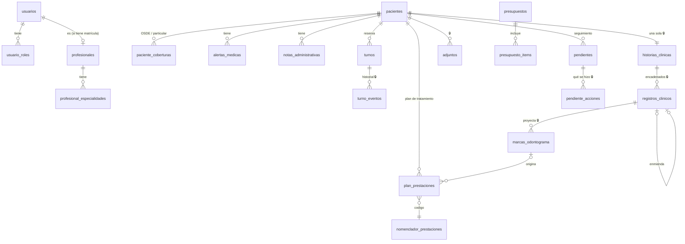

# Modelo de datos

El esquema está en `src/db/schema.ts` y las migraciones en `drizzle/`. Las tablas marcadas con 🔒 son de solo agregar: la base rechaza `UPDATE` y `DELETE`.

## Zonas

| Zona | Tablas | Quién accede |
| --- | --- | --- |
| Ficha del paciente | `pacientes`, `paciente_coberturas`, `notas_administrativas`, adjuntos administrativos | Secretarias y profesionales |
| Alertas médicas | `alertas_medicas` | Las cargan profesionales; las ven todos |
| Historia clínica | `historias_clinicas`, `registros_clinicos`, `marcas_odontograma`, `borradores_clinicos` (solo su autor), adjuntos clínicos | Solo profesionales |
| Agenda y seguimiento | `turnos`, `turno_eventos`, `pendientes`, `pendiente_acciones` | Secretarias y profesionales |
| Plan y presupuestos | `plan_prestaciones`, `presupuestos`, `nomenclador_prestaciones`, `aranceles`, `financiadores` | Profesionales indican; secretarias presupuestan |
| Auditoría | `auditoria_accesos` 🔒 | Administrador |

## Cómo se firma un registro

1. El profesional escribe un borrador en `borradores_clinicos`, que todavía se puede editar.
2. Al firmar, `firmarRegistro` hace todo en una transacción:
   - bloquea la historia clínica;
   - calcula la siguiente secuencia y el hash, encadenado al registro anterior;
   - inserta el registro y proyecta las marcas del odontograma;
   - registra la firma en la auditoría.
3. Un trigger verifica la secuencia y el encadenamiento. Si dos firmas compiten, una falla y se reintenta.
4. Las marcas del odontograma viajan dentro del `contenido` firmado. `marcas_odontograma` es una proyección para consultar rápido, y con el registro solo alcanza para reconstruir el odontograma.

## Qué guarda cada registro firmado

El `contenido` de un registro es el JSON que se firmó. Siempre lleva `firmante` (nombre, apellido y matrícula al momento de firmar).

| Tipo | Contenido |
| --- | --- |
| `evolucion` | `texto`. Si se abrió desde la agenda, `turno_id` apunta al turno. |
| `enmienda` | `texto`. `enmienda_de` apunta al registro corregido, que tiene que ser del mismo autor. |
| `odontograma` | `marcas` (con su `id` y lo que reemplazan o anulan) y, opcional, `texto` con una nota. |
| `adjunto` | `texto` (la descripción) y `adjunto`: `id`, `sha256`, nombre, tipo, tamaño y pieza. |

## Tablas y columnas de la historia clínica conectada

- `profesionales.pin_firma_hash`: huella scrypt del PIN de firma (`scrypt$N$r$p$sal$huella`), nunca el PIN. `pin_firma_actualizado_en`, `pin_firma_intentos_fallidos` (con `CHECK >= 0`) y `pin_firma_bloqueado_hasta` llevan el bloqueo por intentos.
- `borradores_clinicos`: único por `(historia_clinica_id, autor_id, tipo)`. Es la única tabla clínica que se edita y se borra, porque todavía no es historia clínica.
- `adjuntos`: índice por `historia_clinica_id`. Los clínicos se guardan en la carpeta `hc-<id de la HC>` del almacenamiento.

Reglas en la base (`drizzle/0004_historia_clinica_sql.sql`):

- un adjunto clínico solo entra en la historia clínica de su mismo paciente;
- un registro con `turno_id` solo puede citar un turno del mismo paciente;
- un registro de tipo `adjunto` tiene que citar un adjunto de la misma historia clínica, con su misma huella SHA-256.

## Odontograma a una fecha

Las marcas nunca se modifican. Cuando algo cambia, una marca nueva **reemplaza** a la anterior: por ejemplo, una caries a realizar pasa a restauración realizada. Para corregir un error se usa una **anulación**. El estado a cualquier fecha se calcula aplicando las marcas hasta esa fecha (`calcularOdontograma`).

## OSDE y particular

La cobertura se define **por prestación** (`plan_prestaciones.financiador_id`), no solo por paciente. Así un paciente de OSDE puede tener parte del tratamiento como particular, y el presupuesto puede ser mixto.
